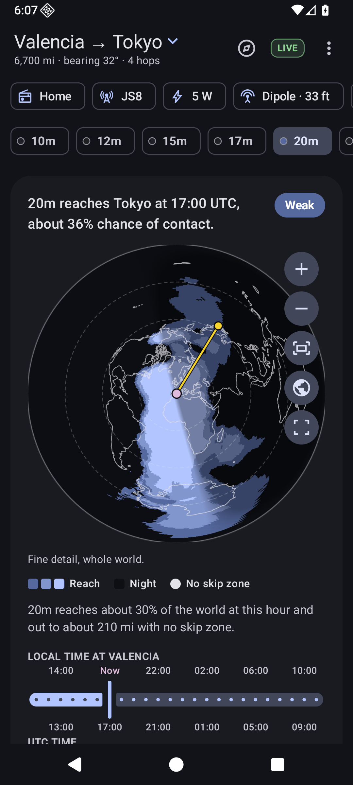
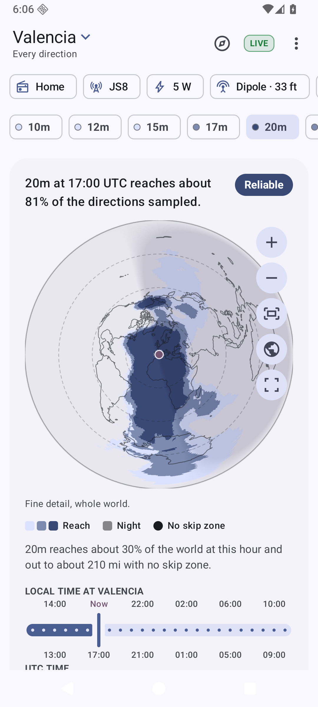
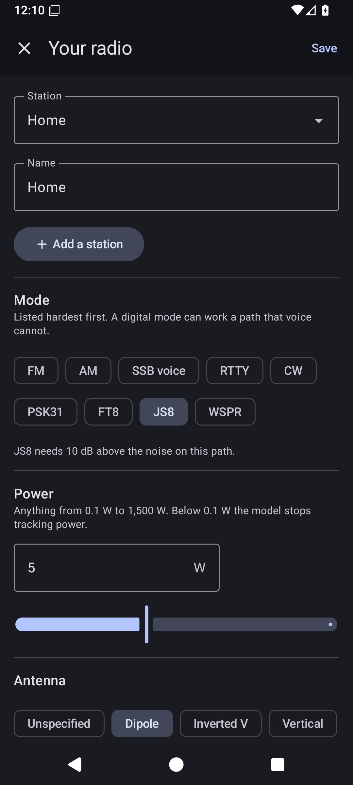
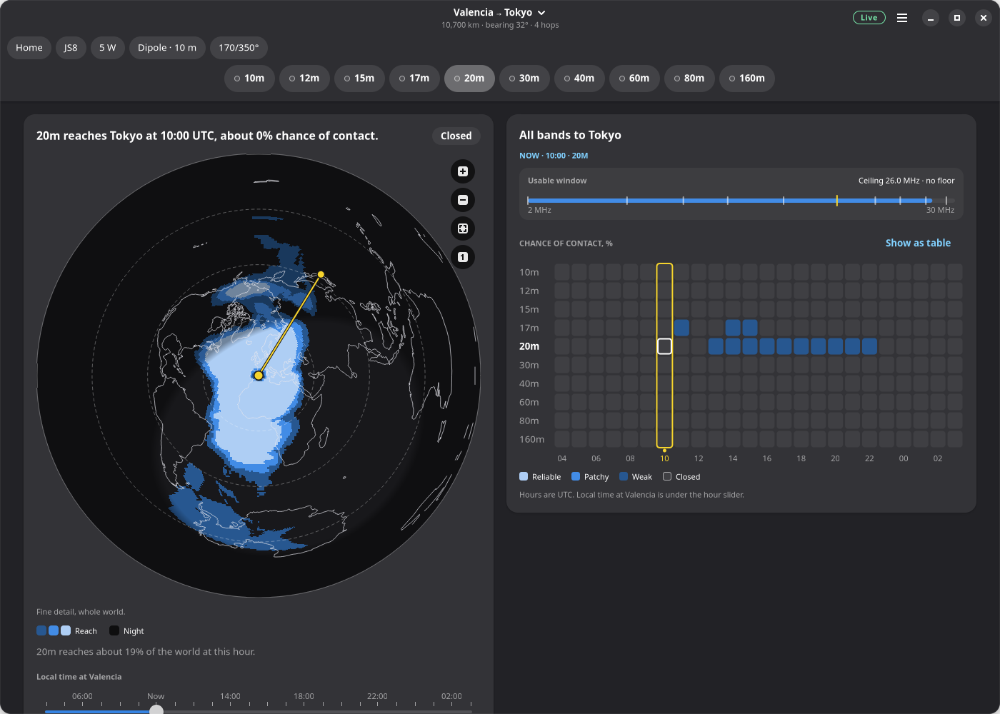

<div align="center">
  
  <h1>HFPredict</h1>
  <p><strong>Which amateur radio bands reach where, hour by hour, worked out on your own device.</strong><br>
  For Android and the Linux desktop, with Windows and macOS builds too. No account, no tracking, no ads; works with no network at all.</p>
  <!-- Stores, one row: F-Droid, Accrescent and Flathub join Obtainium here. -->
  <p>
    <a href="https://apps.obtainium.imranr.dev/redirect?r=obtainium://add/https://github.com/alvaroemtnez/HFPredict"></a>
  </p>
  <p>
    <a href="https://code.alvaroedo.io/alvaroemtnez/HFPredict/releases"></a>
  </p>
  <br>
</div>

<p align="center">
  
  
  
</p>
<p align="center">
  
</p>

## What it does

Pick where you are (and, if you like, where you want to reach), describe your radio, and
HFPredict shows:

- **A coverage map** of where the selected band reaches at the selected hour, centred on
  you: straight lines out from the middle are great circles at their true bearing and
  distance. Zoom in and finer detail is worked out around what you look at. Areas reached by
  near-vertical incidence (no skip zone) are marked.
- **Every band at every hour**, as the chance of a contact with your destination, or as the
  share of directions reached when you have none. Tap any cell to show it on the map.
- **The usable window**, from the lowest to the highest usable frequency, hour by hour.
- **Your station**: mode (FM to WSPR), power (0.1 to 1,500 W), antenna (dipole, inverted V,
  vertical, inverted L, beam), its height and which way it points. Keep several.
- **The sun today**: solar flux, K index and the effective sunspot number from NOAA, and the
  latest measurement from the nearest ionosonde (GIRO), when online.

Forecasts come from the [HFcast engine](https://github.com/jonathanmcsweet/hfcast-engine):
**Truecast** (the default), which tunes VOACAP's physics to the day and beat VOACAP on 77% of
days against ionosonde measurements, and **VOACAP** itself, translated faithfully from the
Fortran. Both run on the device with no network; live readings, when allowed, turn the
forecast into a now-cast.

Light, dark and **low-light** (dim red on black, for your night vision) themes follow the
system's colours: Material You on Android, the desktop's accent colour on Linux. Phones stay in
portrait; tablets and desktop windows get a two-column layout when there is room. English,
Spanish, Valencian, German, Japanese and Arabic.

## Install

- **Android 8.0 or later**: with [Obtainium](https://obtainium.imranr.dev/) (button above),
  or download the APK from the [releases](https://code.alvaroedo.io/alvaroemtnez/HFPredict/releases)
  (`arm64-v8a` fits nearly every phone; `universal` fits all). No Google services needed:
  GrapheneOS, LineageOS and other de-Googled systems are first-class.
- **Linux**: the `.flatpak` bundle (`flatpak install --user HFPredict-*.flatpak`) or the
  `.AppImage` (make it executable and run it) from the releases. Flathub is planned. Any
  desktop works (GNOME, KDE Plasma, Xfce, Cinnamon, a tiling window manager…): the app is
  built with GTK 4 and libadwaita, so it looks most at home on GNOME and carries its own
  styling everywhere else.
- **Windows 10 or later** (x64 or ARM64): the `-setup.exe` from the releases. It installs
  for your user only, with no administrator rights, and has an uninstaller. It is not
  code-signed, so SmartScreen may warn: *More info → Run anyway*.
- **macOS 15 or later** (Apple silicon `arm64` or Intel `x86_64`): the `.dmg` from the
  releases; drag HFPredict into Applications. It is not notarised by Apple, so the first
  launch is refused: open *System Settings → Privacy & Security* and choose *Open Anyway*.

On Windows and macOS, "Use my location" is not available (it relies on the Linux location
portal): search for your place or type your locator instead.

Every release carries a `SHA256SUMS` file, signed (`SHA256SUMS.asc`); the APKs are signed with
the same key on every release. See [docs/verifying.md](docs/verifying.md).

## Privacy

The forecast is worked out on your device; your station, antenna and path never leave it.
The app asks for two Android permissions: network (optional, below) and approximate location,
only when you tap "Use my location". Location comes from the platform, never from Google Play
services.

With the network on, three services see your IP address: NOAA (solar readings), GIRO
(ionosonde measurements) and Open-Meteo (place search, only when the 3,997 built-in places
find too little, and it sees what you typed). Grid squares and coordinates are worked out on
the device. Turn the network off in Preferences and nothing leaves at all.

## Build

Everything builds from scripts that download their own toolchains into the repository
(nothing is installed system-wide). You need `bash`, `curl`, `git`, and `podman` for the
Linux builds.

```sh
tools/rust.sh cargo test --workspace   # the shared core: Rust toolchain into .tools/
android/build.sh debug                 # Android APK -> android/dist/ (JDK, SDK, NDK into android/.tools/)
android/build.sh test                  # Android unit tests and lint
desktop/build.sh run                   # build and run the GNOME app (in a podman container)
desktop/build.sh test                  # Rust format, lints and tests
packaging/flatpak/build.sh             # dist/HFPredict-<version>-x86_64.flatpak
packaging/appimage/build.sh            # dist/HFPredict-<version>-x86_64.AppImage
packaging/windows/build.sh             # dist/HFPredict-<version>-windows-x86_64-setup.exe (cross-built)
```

The Windows ARM64 installer and the macOS `.dmg` files are built natively on the GitHub
mirror's runners (`.github/workflows/`), with the same scripts:

```sh
packaging/macos/build.sh               # on a Mac: dist/HFPredict-<version>-macos-<arch>.dmg
```

More: [docs/architecture.md](docs/architecture.md) for how it fits together,
[docs/releasing.md](docs/releasing.md) for releases and signing.

## Credits

HFPredict is a rewrite of [HFcast](https://github.com/jonathanmcsweet/hfcast) by Jonathan
McSweet, built on his [HFcast engine](https://github.com/jonathanmcsweet/hfcast-engine): a
Rust translation of VOACAP, the Voice of America Coverage Analysis Program by NTIA/ITS
(maintained by Greg Hand), from J.A. Watson's [voacapl](https://github.com/jawatson/voacapl).
Much of HFPredict's shared core is translated from HFcast. Data: CCIR/ITU-R coefficients,
Natural Earth coastlines, NOAA SWPC, GIRO (UMass Lowell), Open-Meteo. Full details and terms
in [NOTICE](NOTICE). Neither NTIA/ITS nor NOAA endorses HFPredict.

## Licence

GPL-3.0-or-later. See [LICENSE](LICENSE). The HFcast engine and the parts translated from
HFcast are Apache-2.0, as recorded in [NOTICE](NOTICE).

## AI use

Most of HFPredict's code, documentation and artwork was written by an AI assistant (Anthropic's
Claude) working with its maintainer, who directs the work, reviews it, tests it on real
devices and is responsible for what is published. The propagation engine is not part of this
repository and was not modified.
